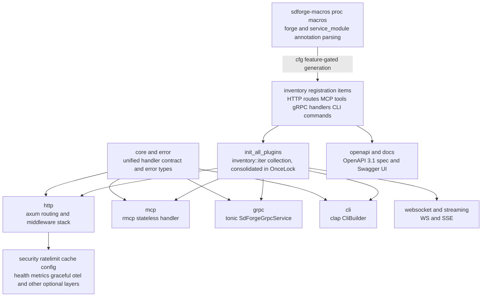
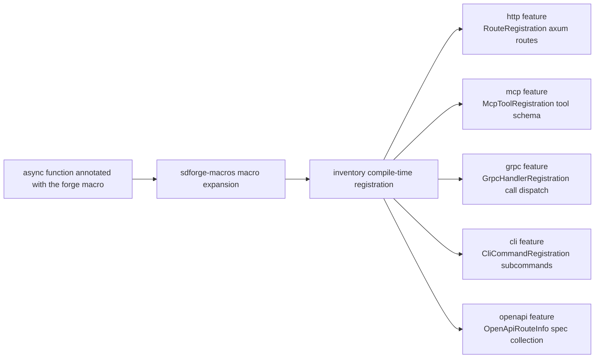
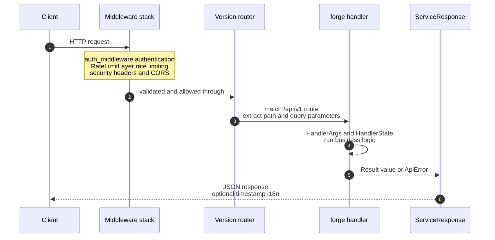

# 🏗️ Sdforge Architecture

This document describes SDForge's design principles, system architecture, module breakdown, data flow, and security and performance design. SDForge is a Rust-based declarative multi-protocol SDK framework: the `#[forge]` proc macro generates multi-protocol (HTTP + MCP + gRPC + WebSocket + CLI) registration code at compile time from unified function annotations, and disabled protocols produce no compiled code at all. For a usage-oriented introduction see the [user guide](USER_GUIDE.md).

## 📋 Table of Contents

<details open>
<summary>📑 Table of Contents</summary>

- [Overview](#-overview)
- [Design Principles](#-design-principles)
- [System Architecture](#-system-architecture)
- [Module Breakdown](#-module-breakdown)
- [Data Flow](#-data-flow)
- [Security Design](#-security-design)
- [Performance Design](#-performance-design)

</details>

## 🧭 Overview

SDForge consists of two crates:

- **`sdforge-macros`**: the proc-macro crate implementing `#[forge]` / `#[service_module]`, responsible for parsing annotations and generating per-protocol registration code gated by features
- **`sdforge`**: the runtime library providing protocol implementations, core types, configuration, security, and documentation generation

The runtime skeleton is built on [inventory](https://crates.io/crates/inventory): registration items generated by the macro (HTTP routes, MCP tools, gRPC handlers, CLI commands, etc.) are submitted at compile time via `inventory::submit!()`, and collected once at application startup by `init_all_plugins()`.

## 🧭 Design Principles

1. **Compile-time protocol selection** — every protocol implementation is gated by `#[cfg(feature = "...")]`. Enabling `http` compiles none of the MCP/gRPC/CLI code; conversely `mcp`, `grpc`, `openapi`, `cli`, `streaming`, and `cache` are independent of `http` (the HTTP registration code generated by `#[forge(path=...)]` is likewise wrapped in `#[cfg(feature = "http")]`). Quantified benefit: `http` only saves about 46–47% of compile time and about 60% of library size versus `full` (see the [compile-time gating benchmarks](VS_SERVER_LESS.md)).
2. **Unified interface definition** — a single `#[forge]` annotation describes the endpoint, and each protocol consumes the same metadata (name, version, description, parameter schema), eliminating cross-protocol duplicate definitions.
3. **Inventory registration pattern** — registrations are submitted at compile time via `inventory::submit!()` and collected at runtime; `init_all_plugins()` caches the collected results in a `OnceLock`, preventing release builds (LTO + dead-code elimination) from stripping the registration items, and returns per-protocol registration counts for self-checks.
4. **Unified registration system** — the four protocol modules (HTTP, MCP, WebSocket, gRPC) share the `define_registration!` macro and the `Registration` trait abstraction, eliminating duplicated boilerplate.
5. **Three construction modes** — every component must support `new()` (works out of the box), `builder()` (Builder pattern), and `with_dependencies()` (dependency injection).
6. **No database** — all data interaction goes through oxcache (in-memory cache); the framework itself has zero external service dependencies. Rate limiting reuses limiteron, logging can bridge to inklog, and dependency injection reuses trait-kit (the `kit` feature).
7. **Unified handler contract** — handlers for all protocols follow `fn(HandlerArgs, HandlerState) -> HandlerFuture`: `HandlerArgs` is constructed from clap / tonic / axum extractors, and `HandlerState` is injected via `downcast_state::<T>()`.

## 🏛️ System Architecture

The full map of module registration and runtime assembly:



Repository layout:

```text
sdforge/
├── src/                # Runtime library
├── macros/             # Proc-macro crate (#[forge])
├── examples/           # Comprehensive example library (workspace member: sdforge-examples)
├── benches/            # Benchmarks
├── proto/              # protobuf definitions (gRPC)
├── docs/               # Documentation (this directory)
├── tests/              # Integration/unit/macro tests
└── scripts/            # Build and utility scripts
```

## 🧱 Module Breakdown

| Module (`src/`) | Feature | Responsibility |
|----------------|---------|------|
| `core/` | none | Core types: `ServiceError` / `ServiceResponse`, `ApiMetadata`, the unified handler contract (`handler.rs`), the inventory registration abstraction (`registration.rs`), JSON utilities, `RegexCache`, validation (`validation.rs`) |
| `error/` | none | Framework errors: `ApiError`, `SdForgeError` / `SdForgeResult`, `ErrorContext`, error i18n |
| `domain/` | none | Domain abstractions (e.g. `ForgeRateLimiter`) consumed by integration layers |
| `i18n/` | `i18n` (formatting part) | Translation registry (always available) + ICU4X `HttpI18nFormatter` |
| `http/` | `http` | Axum protocol implementation: `build()` / `build_with_config_ext()`, version routing, security headers, response construction, route registration; `tls.rs` (`serve-tls`) rustls TLS termination: PEM cert/key loading, ALPN, `ReloadingTls` hot reload, shutdown teardown shared with graceful; `tls-watch` layers confers `FsWatcher` debounced watching on top (`spawn_cert_watcher` drives `reload_async` for automatic reload; the swap-in semantics still go through rustls) |
| `mcp/` | `mcp` | rmcp integration: `StatelessServerHandler`, the HTTP header protocol (`headers.rs`), MRTR sessions (`mrtr.rs`), cache semantics (`cache_semantics.rs`), schema validation |
| `grpc/` | `grpc` | tonic service: `SdForgeGrpcService`, `GrpcServerConfig`, protobuf (`proto/sdforge.v1.proto`, generated by `build.rs` via tonic-prost into `OUT_DIR`), handler registration and interceptors |
| `websocket/` | `websocket` | Connection management (`connection.rs`), handler dispatch (`handler.rs`), broadcast (`broadcast.rs`), message parsing (`message.rs`) |
| `streaming/` | `streaming` | SSE: `StreamEvent` / `StreamResponse`, `stream_to_sse`, `StreamBuilder` |
| `cli/` | `cli` | clap integration: `CliBuilder`, `dispatch`, `GlobalArg`, docs subcommand |
| `security/` | `security` / `ratelimit` / `ratelimit-http` | Authentication (Bearer / API Key, `bearer/`, `types/`; API keys cached in the oxcache `ApiKeyCache` with ttl + capacity eviction), rate limiting (limiteron adapter; the distributed circuit breaker is limiteron's `CircuitBreaker`, with unchanged FailOpen/FailClose semantics), auditing (`audit/`), middleware |
| `cache/` | `cache` | oxcache passthrough and adaptation: `SyncCache` / `SharedCache` / `DashMapCache`, `ResponseCacheLayer` |
| `openapi/` | `openapi` | `OpenApiRouteInfo` collection and utoipa spec generation, `OpenApiBuilder`, path-parameter schema mapping |
| `docs/` | `docs` | Unified documentation output: Swagger UI routes, CLI/MCP Markdown (`generate_docs` / `write_docs`) |
| `config/` | `http` | Modular configuration such as `SdForgeConfig` / `ServerConfig` / `AuthConfig` / `CorsConfig` / `CacheConfig` + centralized defaults + Builder |
| `inklog.rs` | `inklog` | Bare `log` → inklog `LoggerManager` bridge (since 0.5.0-rc it has absorbed the removed in-house `StructuredLogger` stack and is the single entry point for structured logging; rotation goes through inklog's `FileSink`) |
| `integrations/` | `limiteron-integration` / `kit` | trait-kit AsyncKit integration (`SdforgeModule`), `LimiteronForgeAdapter` |

`macros/` (separate crate): `#[forge]` / `#[service_module]` parsing, argument validation, path-parameter extraction and schema generation, feature-gated multi-protocol code generation, trybuild compile-failure tests.

## 🔀 Data Flow

### One Annotation, Five Protocols

The `#[forge]` macro generates registration items for the protocols whose features are currently enabled; disabled protocols generate no code:



### Compile Time

1. The developer annotates `#[forge(name, version, path, method, ...)]`
2. The macro parses and validates arguments (trybuild covers compile-failure cases)
3. Registration code is generated per enabled feature:
   - `http` → `RouteRegistration` (path/method/version) + path-parameter extractors (multiple parameters generate a `Path<(T1, ...)>` tuple destructured in order; scalar Query parameters generate a dedicated extraction struct)
   - `mcp` → `McpToolRegistration` + `input_schema` (required / unknown-field validation)
   - `grpc` → `GrpcHandlerRegistration` (keyed by `grpc_method`)
   - `cli` → `CliCommandRegistration` + `CliHandlerRegistration` (1:1 pairs)
   - `openapi` → `OpenApiRouteInfo` (with `OpenApiPathParam`, path `:id` → `{id}`)
4. All registration items enter the build artifact via `inventory::submit!()`

### Startup

5. `main` calls `init_all_plugins()`: for each registration type it runs `inventory::iter::<T>().collect()` into a `OnceLock<Mutex<Vec<&'static T>>>` (process-level cached, idempotent collection; on mutex poisoning it degrades to returning 0 instead of cascading a panic), returning `PluginCounts`
6. On the HTTP side, `http::build()` builds the Axum `Router` from `RouteRegistration` (including the version prefix `/api/{version}` and `#[service_module]` prefix concatenation)

### Request Phase (HTTP example)

7. The request enters the middleware stack: rate limiting (`RateLimitLayer`, based on the TCP peer IP extracted from `ConnectInfo`; assembled by `http::build_with_config_ext_rate_limited`) → authentication (`auth_middleware`, API Key / JWT Bearer) → security headers / CORS / timeout
8. The version router matches `/api/{version}` and dispatches the request to the target handler; macro-generated extractors deserialize path/query parameters into function arguments
9. The unified handler contract executes: `HandlerArgs` (extractor-constructed) + `HandlerState` (`downcast_state` injected) → business function → `Result<T, ApiError>`
10. Response pipeline: `ServiceResponse` wrapping (explicit `status` / `success_with_status`) → optional timestamp / i18n processing → JSON output



The other protocol entrypoints reuse steps 7–10's tail: MCP routes via the `Mcp-Method` / `Mcp-Name` headers (or stdio) through `StatelessServerHandler` to the same pool of tool handlers; gRPC routes via `SdForgeGrpcService` keyed by `grpc_method` (1 MiB payload cap); CLI runs parse → dispatch → `extract_value` (`Value::String` prints the raw string) → exit code via `CliBuilder::execute()`.

## 🔒 Security Design

- **Authentication**: the `security` feature provides API Key (version management, LRU cache, explicit `ApiKeySeed` seeding, fail-loud on empty store, enforced expiration reverse index) and JWT Bearer (HMAC-SHA256 verification, `MIN_SECRET_LENGTH=32` enforced secret length)
- **Fail-safe defaults**: `ServerConfig` binds `127.0.0.1` by default (not `0.0.0.0`); CORS validation checks both scheme and host, and origins like `"http://"` (scheme only) are rejected
- **Unspoofable client IPs**: without `ConnectInfo`, `X-Forwarded-For` / `X-Real-IP` are not trusted and `None` is returned directly, leaving fallback to the caller; IP rate limiting/banning can only be based on the TCP peer address (trusted proxy ranges are written as CIDR; bare IPs are never mistaken for trusted)
- **Auditing**: `AuditLogger` records security events with HMAC-SHA256 signing against tampering; key rotation actions are audit-logged
- **Error sanitization**: `ApiError::Internal.message` is sanitized before output (no paths/stack traces), and `error_id` supports log-side correlation; `ErrorContext` (with compile-time source path/line) is kept server-side only — even directly serializing `ApiError` carries no internal messages or context
- **Input defense**: MCP tool `input_schema` required / unknown-field validation; 1 MiB payload caps for MCP and gRPC; concurrency safety patterns (mutex/RwLock poisoning awareness, cache consistency lock ordering, usize underflow protection) fixed through systematic audits
- **Supply chain**: `cargo-audit` + `cargo-deny` (`deny.toml` policy) + Dependabot + CodeQL; pre-release enforces SAST scanning (0 CRITICAL) and code review (no HIGH)

The vulnerability reporting process and security best practices are detailed in the [security document](SECURITY.md).

## ⚡ Performance Design

- **Compile-time trimming is the first performance design**: feature gating keeps the dependencies of unused protocols (tonic/prost, rmcp, tokio-tungstenite, argon2/sha2, etc.) entirely out of the compile graph. Measured (2026-07-03): `http` only saves about 47% compile time and about 60% of framework library size versus `full`; see the [compile-time gating benchmarks](VS_SERVER_LESS.md)
- **Zero protocol tax at runtime**: protocol selection happens at compile time; there is no runtime protocol probing or dynamic loading. Runtime hot-path baselines are in the [performance baselines](PERFORMANCE.md)
- **Idempotent registration collection cache**: `init_all_plugins()` caches inventory iteration results in a `OnceLock`; repeated calls cost nothing
- **Regex cache**: `core::RegexCache` caches compiled regexes in an oxcache `ByteWeightCache` (256 KiB byte budget + moka TinyLFU eviction + `get_or_compute` single-flight compilation — concurrent same-pattern compiles only once), avoiding repeated compilation on hot paths; since 0.5.0-rc it replaced the in-house dual-Mutex LRU bookkeeping
- **In-memory caching**: oxcache powers response/tool-result caching with key normalization, pattern invalidation, batch operations, and statistics
- **Release profile**: `lto = "fat"`, `codegen-units = 1`, `opt-level = 3`, `strip = true` to maximize inlining and dead-code elimination (note: link-time elimination can dilute the trimming benefit at the binary level, but compile-time cost savings are unaffected)
